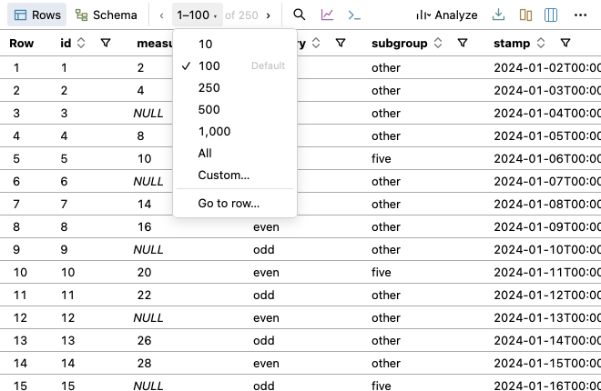
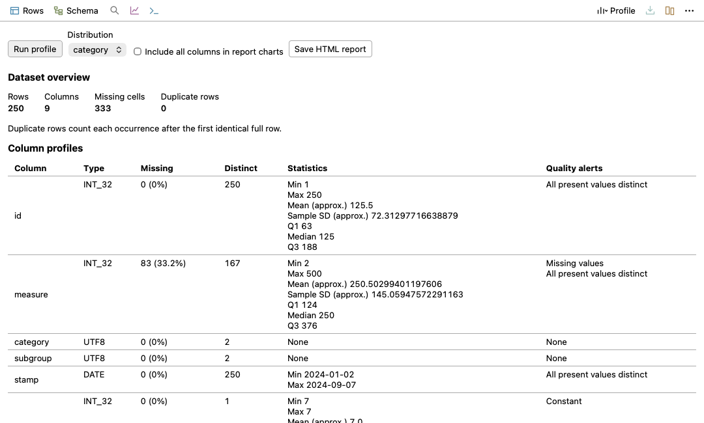
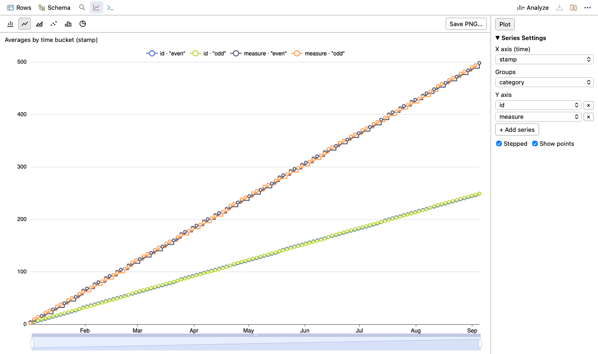

# Parquet Viewer for OpenIDEA

Open a local Parquet file as a read-only data grid. Browse records and inspect row groups
without loading the entire file into the IDE. Connect an installed DuckDB CLI to filter across
the file, run SQL, profile columns, plot relationships, and export results. Every operation
runs locally. Browsing rows and schema works without DuckDB.



## Install a release

**Compatibility:** OpenIDEA v0.1.50 lacks the binary web editor and range-read APIs this plugin
requires. Use a build containing the [binary web editor changes](https://github.com/l0ng-ai/openidea/pull/4914).

1. Download the `.oiplugin` asset from [GitHub Releases](https://github.com/faysou/openidea-parquet-plugin/releases).
1. In OpenIDEA, open **Settings > Plugins**, click the gear, and choose **Install Plugin from Package File…**.
1. Select the downloaded file, review the unsigned plugin prompt, and confirm installation.
1. Open a `.parquet` file. To use analytics, enable the optional DuckDB permission and choose your local
   `duckdb` executable under **Settings > Plugins > Parquet Viewer**.

## Query with DuckDB

If DuckDB is installed, open the **Query** tab and approve the executable in
**Settings > Plugins > Parquet Viewer**. Query the open file as `parquet_data`.
Each run accepts one `SELECT` and displays up to 200 rows. **Summarize** shows
column statistics for the file. Rows and Schema are available without DuckDB.

```sql
SELECT event, count(*) AS rows
FROM parquet_data
GROUP BY event
ORDER BY rows DESC
```

## Explore and profile a file

Open **Analyze** in the toolbar for **Explore**, **Profile**, and **Relationships**.

**Explore** selects columns, combines typed filters, and sorts the matching records across the file.
Use **Group by** or **Pivot** to summarize groups. Use **Open in Query** to edit the resulting SQL
or export all matches. The SQL editor also includes templates for missing-value patterns, duplicates,
text lengths, time gaps, moving averages, and outlier capping.

**Profile** reports missing values, duplicates, and statistics by column type. Choose a column to inspect
its distribution. **Save HTML report** saves the overview for offline use. Include the selected distribution or request distributions for every column.



**Relationships** ranks associations for selected columns or a target. Each result identifies its
metric and the number of complete observations. Open a result for a chart or a group breakdown.
The panel labels its sample when the file exceeds its row limit.

## Inspect, chart, export, and compare

- In **Rows**, click a column name to cycle between ascending, descending, and source order. Click
  the funnel beside a column name to filter by value. These actions apply to the current page by
  default. Choose **Whole file** in the filter control to run them across the file with DuckDB.
- Click the page range at the upper left. Select a size to apply it immediately.
  Use **Custom…** to enter another size or **Go to row…** to jump to a record. The maximum is 1,000 rows per page and decreases for wide schemas. **All rows** is available
  when the entire file fits in the page.
- Use **Manage columns** to hide, reorder, or pin fields. **View options** offers transposed,
  tree, and text layouts. Click a row number to open its record. Expand nested lists and structs in the record panel.
- In **Schema**, select a row group to inspect per-column compression, byte sizes, null counts,
  and available minimum and maximum bounds from its footer.
- Click **Chart** in Rows to open a plot below the grid. For more space, choose
  **Open chart in full view** under **View options**. Use the series settings to plot category counts, a numeric histogram, a scatter plot, or averages
  over time. Line, area, and scatter plots support grouping and multiple Y series. Line and area plots also support stepped lines and point markers. **Save PNG** exports the plot.
  DuckDB calculates the chart from the open file. Scatter plots sample up to 200 points.
- Use **Export** to save the displayed rows as CSV. With DuckDB, you can export the entire file
  or all rows from the last query as CSV or Parquet. The Save dialog chooses the destination.
  Parquet export requires a new file.
- Use **Compare** to choose a second Parquet file. Compare schemas on their own, or choose a
  unique, non-null key column to find added, removed, and changed rows in matching schemas.
  The result shows up to 200 differences. Choose **Column distributions** to compare populations by
  missingness and frequencies even when the files have different numbers of rows.



Whole-file export and comparison require an OpenIDEA build with binary editor file actions.

## Install from a local checkout

Build the web assets and the WebAssembly component at the repository root. The build requires
Node.js 24, pnpm 11, and Rust with the WASI Preview 2 target.

```bash
git clone https://github.com/faysou/openidea-parquet-plugin.git
cd openidea-parquet-plugin
pnpm install --frozen-lockfile
pnpm build
rustup target add wasm32-wasip2
cargo build --locked --release --target wasm32-wasip2
mkdir -p dist
cp target/wasm32-wasip2/release/openidea_parquet_plugin.wasm dist/plugin.wasm
```

For a local installation, choose **Settings > Plugins > gear > Install Plugin from Disk…**
and select the built repository folder containing `plugin.toml`.

For development, run `openidea-plugin link .` with the CLI built from a compatible OpenIDEA
checkout. Set `OPENIDEA_PLUGINS_DIR` first if your dev app uses an isolated plugins directory.
Rebuild after editing the plugin, then reload it in the IDE.

## Release packaging

Run `python3 scripts/package.py` after building to create the installable archive under `dist/`
(Python 3.11 or later). Maintainers release by pushing a tag such as `v0.1.0` on the intended
commit. GitHub Actions checks that the tag matches the versions in `plugin.toml`, `Cargo.toml`,
and `package.json`, runs the tests with DuckDB, builds the plugin, and attaches the archive to a
GitHub Release. One package contains the web assets and the portable WebAssembly component.

## Architecture and file limits

**Opening a Parquet file has no 64 MiB input limit.** That limit belongs to OpenIDEA's
whole-buffer file API, which the plugin uses for outputs such as HTML reports and PNG charts.
The plugin uses two paths to read Parquet data.

- **Browse.** The JavaScript viewer runs in an OpenIDEA webview. Hyparquet reads the footer
  through the host's byte-range API, then requests the column chunks or pages needed for the
  displayed rows. Each host read is at most 1 MiB. A single decoder request can span up to
  32 MiB. Reading one preview page can request up to 96 MiB of file data and up to 64 MiB of
  output from the compressed-page decoders. An oversized footer can prevent the viewer from
  opening. An oversized data section can prevent a particular page from displaying.
- **Analyze.** The webview sends requests to the plugin's Rust WebAssembly component. After
  the user grants permission, the OpenIDEA host runs the installed DuckDB CLI, which reads
  the selected file directly from disk. DuckDB uses two threads, a 256 MiB memory setting,
  and no temporary disk spill. A scan can process a file larger than that memory budget.
  Operations such as sorting or grouping many distinct values can exhaust it.

The query grid displays up to 200 result rows. Full-result CSV and Parquet exports use DuckDB
to write directly to the destination chosen in the Save dialog, bypassing the grid's row limit
and the whole-buffer transfer limit.

Run the decoder tests with `pnpm test`.
